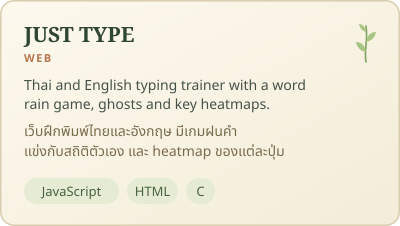
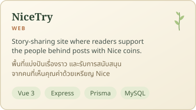
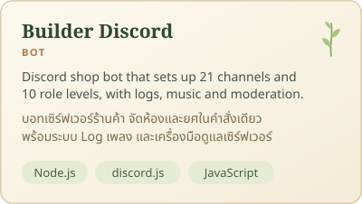
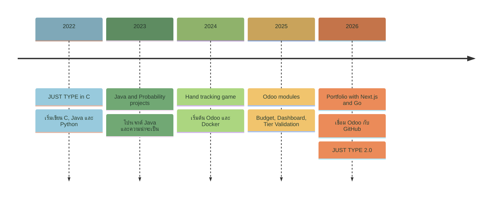
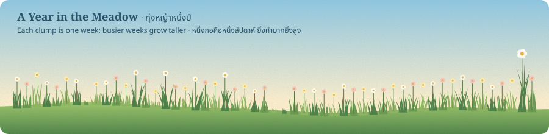

<!-- The meadow, stats and note images are rebuilt daily by .github/workflows/refresh-profile.yml -->

  <a href="#contact">Contact · ติดต่อ</a> &nbsp;•&nbsp;
  <a href="#tools">Tools · เครื่องมือ</a> &nbsp;•&nbsp;
  <a href="#projects">Projects · ผลงาน</a> &nbsp;•&nbsp;
  <a href="#path">Path · เส้นทาง</a> &nbsp;•&nbsp;
  <a href="#meadow">Meadow · ทุ่งหญ้า</a>

<h2 id="contact">Contact · ติดต่อ</h2>

  
  

Leave a message through the link above, or open an issue on any of my repositories.

ฝากข้อความได้จากลิงก์ด้านบน หรือเปิด issue ใน repo ไหนก็ได้

<h2 id="tools">Tools · เครื่องมือ</h2>

**Everyday · ใช้เป็นประจำ**

 

**Web · สร้างเว็บและ API**

**Learning · กำลังเรียนรู้**

**Also used · เคยใช้**

<h2 id="projects">Projects · ผลงาน</h2>

### [JUST TYPE](https://github.com/madara1150/WPM)

A Thai and English typing trainer that began as a C console program and grew into a dependency-free web app, with the Word Rain game, personal-best ghosts, badges and per-key heatmaps. [Try it here](https://madara1150.github.io/WPM/).

เว็บฝึกพิมพ์ไทยและอังกฤษ ต่อยอดจากโปรแกรมภาษา C ใน command prompt มาเป็นเว็บแอปที่ไม่มี dependency มีเกมฝนคำ แข่งกับสถิติตัวเอง เหรียญรางวัล และ heatmap ของแต่ละปุ่ม [ลองเล่นได้ที่นี่](https://madara1150.github.io/WPM/)

### More · ผลงานอื่นๆ

  
  
  

<h2 id="path">Path So Far · เส้นทางที่ผ่านมา</h2>

<h2 id="meadow">Meadow · ทุ่งหญ้า</h2>

  

  
  

  

Refreshed every morning · อัปเดตใหม่ทุกเช้า

